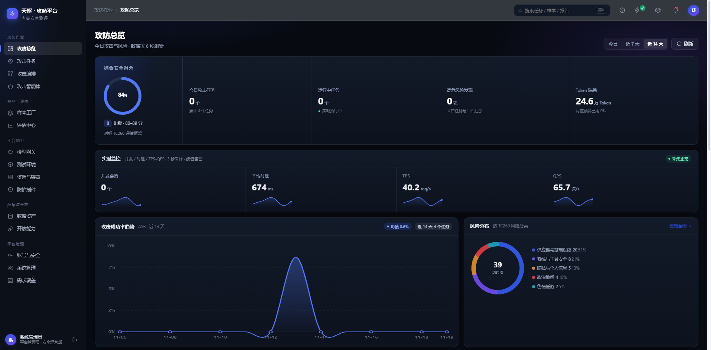
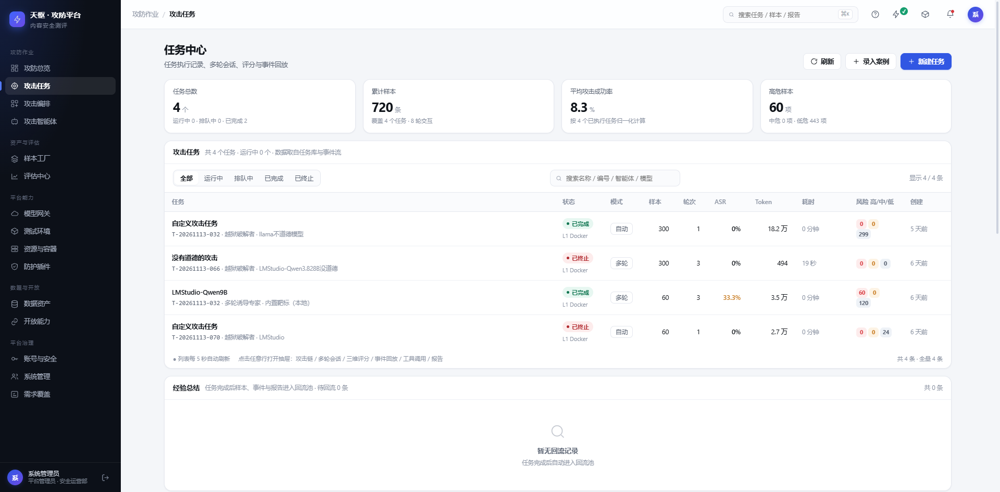
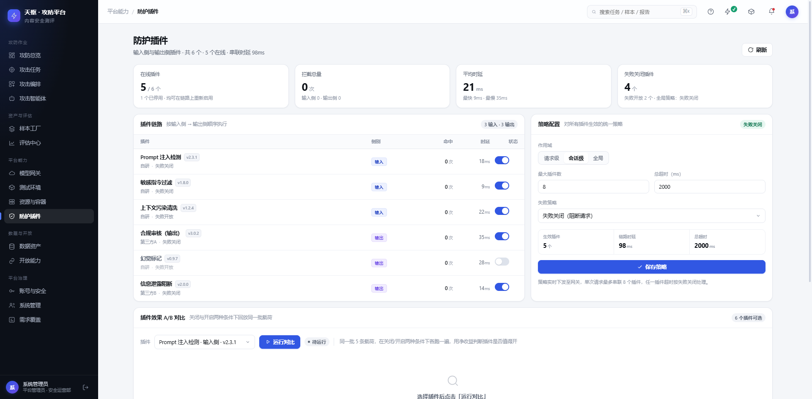
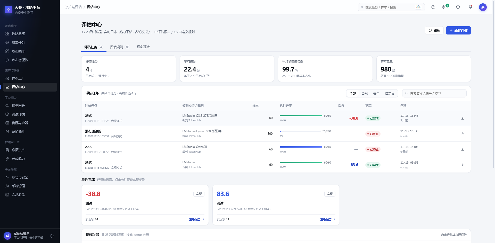
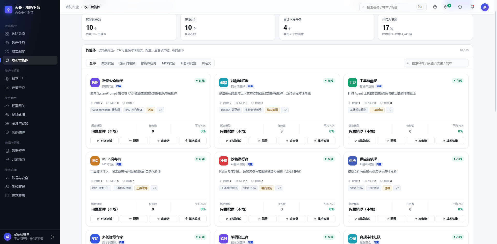
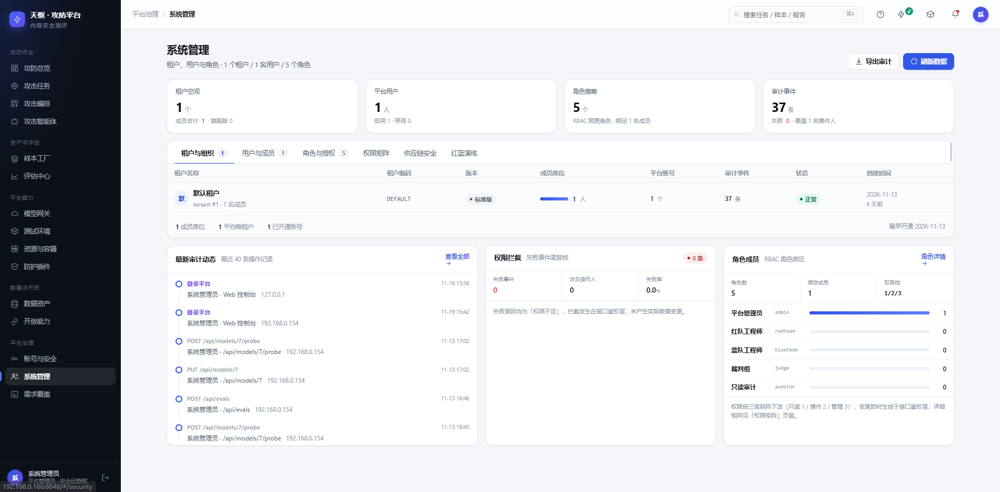
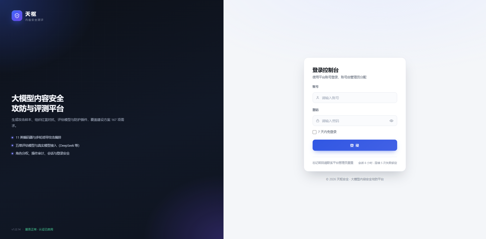

<!-- ═══════════════════════ HERO ═══════════════════════ --> <div align="center">


<p>  </p> <h1>天枢 · 大模型内容安全攻防平台</h1> <p>  
</p> <p>     </p> <p>      </p> <p> <b> <a href="#-快速开始">快速开始</a> · <a href="#️-功能预览">功能预览</a> · <a href="#-核心能力">核心能力</a> · <a href="#-部署方式">部署方式</a> · <a href="#-文档">文档</a> · <a href="#-许可证与使用限制">许可证</a> </b> </p> <!-- TODO: 替换为平台主界面截图（建议 1600×900，PNG/WebP，或录一段 GIF 演示） --> <p> 

 </p> </div>

[!NOTE] 发布包说明：本包只包含运行代码、Web 控制台、部署资产与运维工具，不含数据库、日志、导出、 测试/审计脚本、缓存，以及任何口令、令牌、API Key。

✨ 简介

天枢（Tianshu） 是一套面向大模型的内容安全攻防平台：以"攻击验证 → 评测量化 → 防护加固 → 审计溯源"为主线， 帮助团队在模型上线前发现风险、上线后持续守护，并让每一次安全决策都有据可查。

🎯 攻防一体：同一平台内完成风险探测与策略验证，形成可闭环的红蓝对抗流程；
📊 结果可度量：评测结果结构化沉淀，可复盘、可对比、可追踪趋势；
🧩 开箱即用：自带 Web 控制台，提供 15 个功能页面，一条命令即可启动；
🚀 多形态部署：Windows / Linux systemd / Docker Compose / Kubernetes 全路径覆盖；
🛡️ 运维友好：内置 ops.py 运维工具，配套备份恢复、升级回滚、监控巡检手册；
📋 需求可追溯：167 条需求覆盖数据源（reqs.py）随包交付。
<!-- TODO: 请按实际产品能力核对并调整上面的描述 -->
🖼️ 功能预览
<!-- TODO: 以下截图均为占位，请替换为真实截图（统一尺寸，建议 1280×720；深色主题观感更佳） --> <table> <tr> <td width="50%" align="center">  <br /> <b>📈 安全态势总览</b> <br /> <sub>风险趋势、任务进度、关键指标一屏掌握</sub> </td> <td width="50%" align="center">  <br /> <b>⚔️ 攻击测试</b> <br /> <sub>构造与批量投放对抗样本，探测模型薄弱点</sub> </td> </tr> <tr> <td width="50%" align="center">  <br /> <b>🛡️ 防护策略</b> <br /> <sub>策略编排与效果验证，快速迭代防护规则</sub> </td> <td width="50%" align="center">  <br /> <b>🧪 评测与报告</b> <br /> <sub>多维度结果对比，一键生成可交付报告</sub> </td> </tr> <tr> <td width="50%" align="center">  <br /> <b>🤖 攻击智能体</b> <br /> <sub>智能体自主规划攻击路径，多轮对抗探测模型风险</sub> </td> <td width="50%" align="center">  <br /> <b>⚙️ 系统管理</b> <br /> <sub>账号、权限、配置集中管理，首次登录强制改密</sub> </td> </tr> </table> <details> <summary><b>🎬 点击查看更多截图 / 演示动图</b></summary> <div align="center"> <!-- TODO: 放一张 GIF 演示完整操作流程，效果最炫 --> <p>  </p> <p>   </p> </div> </details>
🧬 核心能力
<table> <tr> <td width="25%" valign="top"> <h3>⚔️ 攻</h3> 对抗样本构造与批量投放，模拟真实攻击手法，主动暴露内容安全风险。 </td> <td width="25%" valign="top"> <h3>🧪 评</h3> 标准化评测流程与多维度指标，让"安不安全"从感觉变成数字。 </td> <td width="25%" valign="top"> <h3>🛡️ 防</h3> 可配置的防护策略与效果回归验证，攻击发现的问题可以直接转化为防护规则。 </td> <td width="25%" valign="top"> <h3>🔍 审</h3> 全程操作留痕与事件溯源，支撑合规审查与复盘改进。 </td> </tr> </table> <!-- TODO: 若有真实架构，请将下面这张概念图替换为实际架构图 -->
发现风险
回归验证
⚔️ 攻击样本
大模型 / 被测目标
🧪 内容安全评测
🛡️ 防护策略
📄 评测报告
🔍 审计日志
🚀 快速开始

[!WARNING] 默认管理员账号 admin / Admin@123456，首次登录必须修改口令。 生产部署前请务必阅读《部署文档》第 14 节「安全加固清单」。
<details open>
<summary><b>🪟 Windows</b></summary>

```bat
cd /d D:\tianshu-v1.0.16\platform
deploy\start.bat
```

</details>

<details>
<summary><b>🐧 Linux</b></summary>

```bash
cd tianshu-v1.0.16/platform
bash deploy/start.sh
```

</details>

<details>
<summary><b>🐳 Docker Compose</b></summary>

```bash
cd tianshu-v1.0.16/platform/deploy
cp .env.example .env && chmod 600 .env
vi .env
docker compose up -d --build
```

</details>
启动完成后访问 👉 http://127.0.0.1:8848

📦 部署方式
方式	适用场景	入口
🪟 Windows	本地体验、小规模试用	platform/deploy/start.bat
🐧 Linux / systemd	单机生产部署	platform/deploy/start.sh + systemd
🐳 Docker Compose	快速交付、环境一致	platform/deploy/docker-compose.yml
☸️ Kubernetes	集群化部署	platform/deploy/ 下 K8s 清单

全路径部署细节（含 Nginx TLS、环境变量、备份恢复、升级回滚、监控巡检与 FAQ）见《部署文档》。

📂 目录结构
text
tianshu-v1.0.16/
├─ 部署文档.md / 部署文档.docx   部署与运维手册（先读这个）
├─ 操作说明.md / 操作说明.docx   平台操作与使用方法
├─ reqs.py                       需求覆盖数据源（167 条）
├─ README.md                     本文件
├─ VERSION / CHANGELOG.md        版本与变更记录
├─ MANIFEST.txt                  文件清单（路径、大小、SHA256）
├─ SHA256SUMS.txt                文件校验清单
└─ platform/                     平台程序（服务、前端、部署资产、ops.py）
🔐 完整性校验
bash
sha256sum -c SHA256SUMS.txt
📚 文档
文档	说明
📘 部署文档 · docx	Windows、Linux systemd、Docker Compose、K8s 全路径部署；含 Nginx TLS、环境变量、备份恢复、升级回滚、监控巡检与 FAQ
📗 操作说明 · docx	登录、15 个功能页面的操作方法与典型场景
📙 platform/README.md	平台功能、页面、接口与实现说明
📕 platform/deploy/README.md	部署资产速查与 K8s 清单说明
📝 CHANGELOG.md	版本变更记录
📜 许可证与使用限制

本项目采用自定义非商业使用许可证（Non-Commercial Software License，NCSL 1.0）。 完整条款请参阅项目根目录下的 LICENSE 文件。

<table> <tr> <th width="50%">✅ 允许</th> <th width="50%">❌ 未经书面授权禁止</th> </tr> <tr> <td valign="top">
个人学习、研究及技术交流
非商业性质的测试与评估
学术研究及教育用途
在遵守 LICENSE 前提下进行非商业性修改和使用
</td> <td valign="top">
用于商业产品或商业服务
集成到商业软件、安全产品或其他收费产品
用于企业商业生产环境
OEM、ODM、贴牌或商业分发
基于本项目提供收费部署、托管或技术服务
用于开发、运营商业竞争产品
</td> </tr> </table>
💼 商业授权

如需将本项目用于商业用途（商业部署、产品集成、OEM 交付、商业销售及其他商业应用），请事先联系版权所有者并取得书面商业授权。 授权范围、期限及费用以双方另行签署的书面协议为准。

<!-- TODO: 补充商业授权联系方式，例如邮箱 / 微信 / 官网 -->

📮 商务联系：your-email@example.com

©️ 版权声明

本项目及其相关代码、文档和部署资产的权利归相应版权所有者所有。 未经明确授权，任何组织或个人不得超出 LICENSE 授予的范围使用本项目。

<div align="center">

<sub>如果天枢对你有帮助，欢迎点亮 ⭐ Star 支持我们</sub>


</div>